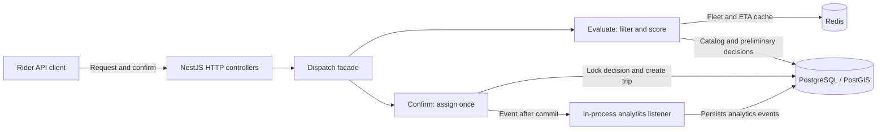

<!-- markdownlint-disable-next-line MD041 -->
<div align="center">

<h1>NexRide</h1>

<p><strong>A dispatch API for electric fleets that ranks vehicles and offers nearby pickup options.</strong></p>

<p>
<a href="https://github.com/diegnghtmr/NexRide/actions/workflows/ci.yml"></a>


<a href="LICENSE"></a>
</p>

<p>
<a href="https://diegnghtmr.me/en/work/nexride/"><strong>Case study</strong></a> &bull;
<a href="#quick-start"><strong>Quick start</strong></a> &bull;
<a href="#architecture"><strong>Architecture</strong></a>
</p>

</div>

The closest electric vehicle isn't always eligible: it may be busy, low on charge, or reporting stale telemetry. NexRide ranks eligible vehicles, explains when a nearby catalog pickup scores better, and lets the rider choose before the API assigns a trip. It is a backend slice, not a rider app or fleet dashboard.

## Features

- **Fleet eligibility.** Filter nearby Redis fleet snapshots on status, eligibility, battery reserve, and telemetry age before ranking them.
- **Explainable ranking.** Score proximity, energy, pickup safety, and fleet continuity with explicit weights and return the individual scores.
- **Pickup choice.** Keep the original pickup available and suggest a catalog point within 120 m by default if its relative safety score improves by at least 15%.
- **One assignment per request.** Confirm the rider's choice in a database transaction that locks the preliminary decision and creates the trip.
- **Catalog management.** Manage safe points through role-gated, audited `/safe-points` endpoints.
- **Operational signals.** Record dispatch and trip events for analytics, log correlated requests, serve Prometheus metrics, and apply user and IP rate limits.

## Quick start

Use Node.js **22.12+** on the Node 22 line, npm **10+**, and Docker Compose. The manifest permits Node versions below 25, but the architecture gate should run on Node 22. The development Compose file provides PostGIS and Redis; wait for both services to be healthy before migrating the disposable database.

```sh
git clone https://github.com/diegnghtmr/NexRide.git
cd NexRide
npm ci
docker compose up -d postgres redis
```

Set `DATABASE_URL` to the local Compose database `nexride_dev` and `REDIS_URL` to `redis://localhost:6379`. Supply the local PostgreSQL username and password from the development Compose configuration, not from a production database. For loopback request testing only, set `NODE_ENV=development` and `TEST_CONTEXT_GUARD_ENABLED=true`.

```sh
npm run migrate
npm run dev
```

Open `http://localhost:3000/api` for the development OpenAPI UI. The local test identity mechanism is disabled in production; it is not rider authentication. To get an assignment rather than a no-candidate result, populate the disposable datastore with fixture fleet snapshots and pickup points using the [performance fixture](test/performance/seed.ts) workflow in [CI](.github/workflows/ci.yml).

| Variable | Purpose | Default |
| --- | --- | --- |
| `DATABASE_URL`, `REDIS_URL` | PostGIS database and Redis fleet/cache connections. | Set explicitly for the local services |
| `NODE_ENV`, `PORT`, `LOG_LEVEL` | Runtime mode, HTTP port, and Pino verbosity. | Unset, `3000`, `info` |
| `TEST_CONTEXT_GUARD_ENABLED` | Enable fixture identities outside production. | Disabled |
| `DISPATCH_CANDIDATE_RADIUS_KM`, `DISPATCH_SAFE_POINT_RADIUS_M` | Search radii for vehicles and pickup locations. | `5`, `120` |
| `DISPATCH_SUGGESTION_THRESHOLD_PCT`, `DISPATCH_ORIGINAL_SAFETY_BASELINE` | Minimum relative improvement and original pickup baseline. | `0.15`, `0.30` |
| `DISPATCH_W_PROXIMITY`, `DISPATCH_W_ENERGY`, `DISPATCH_W_SAFETY`, `DISPATCH_W_CONTINUITY` | Score weights, which must sum to 1. | `0.30`, `0.25`, `0.25`, `0.20` |
| `DISPATCH_SCORING_CONTINUITY_BATTERY_WEIGHT`, `DISPATCH_SCORING_CONTINUITY_ZONE_WEIGHT` | Continuity subscore weights, which must sum to 1. | `0.70`, `0.30` |
| `DISPATCH_PIPELINE_TIMEOUT_MS`, `DISPATCH_FALLBACK_MIN_BATTERY`, `DISPATCH_MAX_ETA_SECONDS` | Evaluation timeout, fallback battery percentage, and ETA cap. | `1200`, `20`, `600` |
| `FLEET_MINIMUM_RESERVE_PCT`, `FLEET_TELEMETRY_STALENESS_SEC` | Trip battery reserve fraction and telemetry freshness limit. | `0.15`, `60` |
| `DISTANCE_CACHE_TTL_SEC`, `DISTANCE_PROVIDER_TIMEOUT_MS`, `DISTANCE_INJECT_TIMEOUT` | ETA cache lifetime, provider timeout, and deterministic timeout for local tests. | `60`, `800`, `false` |

## Architecture

A modular NestJS monolith exposes `POST /rides/request` for evaluation and `POST /rides/confirm` for assignment. `DispatchFacade` delegates to two use cases. Cross-module dependencies use the shared ports and events; other modules do not import dispatch domain or application internals. The distance adapter estimates travel at a fixed 25 km/h using Haversine distance, caches estimates in Redis, and can be replaced behind `IDistanceProvider`. It does not account for road routes or traffic.



Safety is catalog-based, not a live street assessment. With no eligible candidate the API can return `422`; the trip lifecycle ends at assignment, and `dispatch.cancelled` is event scaffolding only. Decision coordinates are stored as doubles; safe points use PostGIS geography for proximity queries. [Scope](SCOPE.md), the [traceability matrix](docs/traceability-matrix.md), and the [ADRs](docs/adr/) document the details, including the distance and flag providers and the in-process event bus.

The status labels below are quoted from [Scope](SCOPE.md):

| Capability | Scope status | Requirement |
| --- | --- | --- |
| Rate limits by user and IP | Implementado | NFR-17 |
| Correlated Pino logs | Implementado | NFR-18 |
| Prometheus `GET /metrics` | Implementado | NFR-19 |
| Configured alerts | Fuera de Alcance | NFR-20 |
| Distributed OpenTelemetry tracing | Fuera de Alcance | NFR-21 |

## Tech stack

| Layer | Technology |
| --- | --- |
| HTTP and application | NestJS 11, Express, TypeScript 5.5 |
| Data | TypeORM, PostgreSQL 16 / PostGIS 3.4, Redis 7 |
| Observability | Pino, `prom-client`, NestJS Throttler |
| Quality | Jest 29, Testcontainers, dependency-cruiser, k6 |

## Testing

```sh
npm run lint
npm run typecheck
npm run format:check
npm run arch:check
npm run test:unit
npm run test:cov
npm run test:integration
npm run build
npm run openapi:generate
```

The [seven-job CI pipeline](.github/workflows/ci.yml) gates documentation and environment-example consistency, lint and types, dispatch isolation, coverage, integration, performance, production dependency audit and secret scanning, and build with OpenAPI generation. Integration uses PostGIS and Redis; the integration harness needs Docker unless external services are supplied. Generation writes `dist/openapi.json` and uses the service configuration.

The k6 smoke test (`npm run test:performance`) needs k6, a running app, and the CI performance fixtures. Its gates are `p95<800ms`, `p99<1200ms`, and successful response checks; these are test thresholds, not production measurements. The production audit (`npm run audit`) excludes development dependencies. dependency-cruiser 16.4 needs Node 22 for the architecture check; see [ADR-009](docs/adr/ADR-009-arch-check-node-compat.md).

## Project structure

```text
src/dispatch/       Facade, use cases, domain logic, and adapters
src/fleet/          Redis read-side
src/safe-points/    Catalog, auditing, and permissions
src/trip/           Trip assignment
src/analytics/      Dispatch and trip event listeners
src/common/         Configuration, ports, events, and observability
src/migrations/     Database migrations
test/               Unit, integration, architecture, and performance suites
```

## Documentation

- [Dispatch reference](docs/dispatch-reference.md) records the first five design decisions and additional local verification commands.
- [Scope and requirements](SCOPE.md) and the [traceability matrix](docs/traceability-matrix.md) map implementation and tests to requirement IDs. The [ADR directory](docs/adr/) contains ADR-006 through ADR-016.

## License

[MIT](LICENSE).
